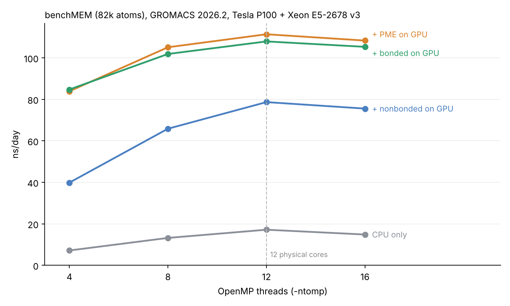
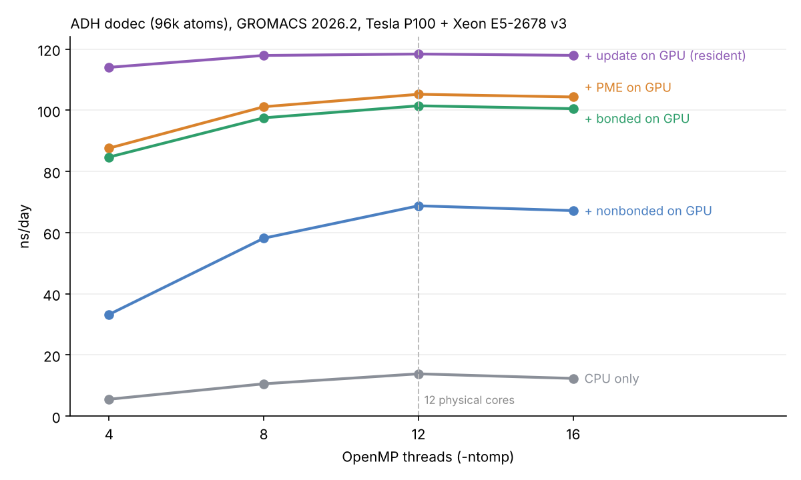
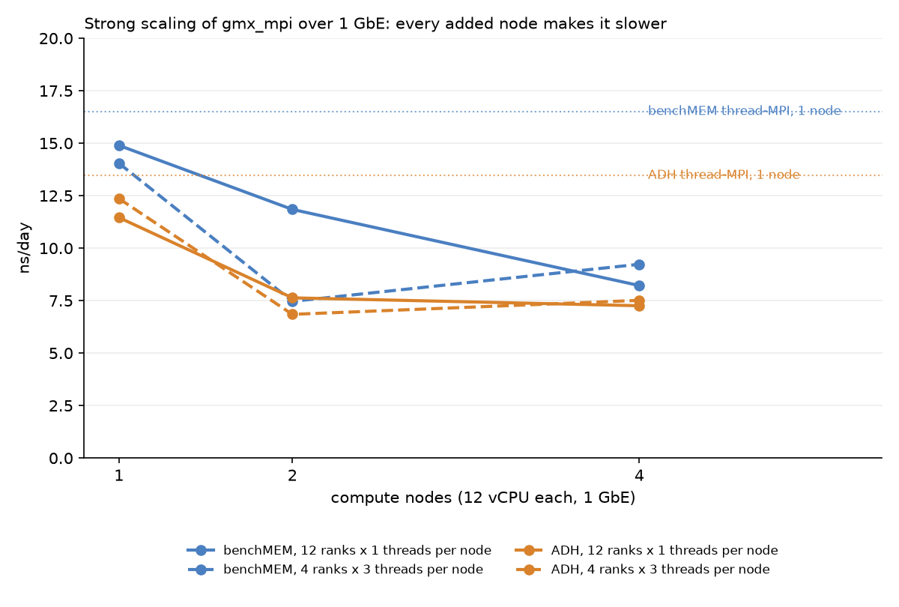

# GROMACS molecular dynamics on a home HPC cluster

Measuring what each layer of hardware actually buys you in molecular dynamics, in ns/day **and** in energy per simulated nanosecond, on a 5-node RHEL cluster with one usable Tesla P100. Every number here is measured on that hardware, including the ones that contradicted my expectations.

**The short version:** moving the whole MD step onto the GPU gives 8.6x the throughput of the same host's CPUs and uses 7.3x less energy per nanosecond. Spreading one simulation across multiple nodes over 1 GbE makes it *slower* than a single node, at every node count I tried. The practical consequence is ensembles, not domain decomposition.

---

## Hardware

| Host | Role | Spec | Network |
|---|---|---|---|
| gpu-host | GPU host, bare metal | Xeon E5-2678 v3 (12 cores), 128 GB, Tesla P100 16GB + Tesla V100 16GB | home LAN only |
| head-node | head, NFS, Slurm controller | ESXi VM, 32 GB | dual-homed |
| node02..05 | compute nodes | ESXi VMs, 12 vCPU, 7.6 GB each | 1 GbE, ~112 µs latency |

All VMs share one ESXi host: 2 × Xeon E5-2696 v3, 36 physical cores, 72 threads, 256 GB. That matters for the multi-node results below.

The V100 is reserved for a RAG assistant that runs permanently, so all GPU work here uses the P100. GROMACS 2026.2, CUDA 12.4, driver 550, AVX2_256, pinned for the whole study.

Two benchmark systems: **benchMEM** (81,743 atoms, the MPI-NAT standard) and **ADH dodec** (95,561 atoms, from the GROMACS developers' own set, rebuilt with `gmx grompp` 2026.2).

---

## Result 1: offload the whole step, not part of it





| Config (ADH, 12 threads) | ns/day | vs CPU-only | CPU pkg | GPU board | Wh per ns |
|---|---|---|---|---|---|
| CPU only | 13.8 | 1.0x | 117 W | 25 W idle | 247 |
| + nonbonded on GPU | 68.8 | 5.0x | 93 W | 97 W | 66 |
| + PME on GPU | 105.2 | 7.6x | 82 W | 114 W | 45 |
| + bonded on GPU | 101.5 | 7.3x | 77 W | 118 W | 46 |
| **fully GPU-resident** | **118.4** | **8.6x** | **41 W** | 126 W | **34** |

Three things worth pulling out:

- **PME offload is the big step, not nonbonded.** At 4 threads, moving PME to the GPU more than doubles throughput (39.9 → 83.9 ns/day on benchMEM). Offloading nonbonded alone leaves the CPU doing the FFT work and bottlenecking everything.
- **Offloading bonded forces makes it slightly slower.** About 3%, consistently, on both systems. Once nonbonded and PME are on the GPU, the GPU is on the critical path and the CPU has idle time, so bonded forces on the CPU are free. Moving them just lengthens the GPU queue. More offload is not automatically faster.
- **In GPU-resident mode the thread count barely matters.** 4 threads give 96% of the peak, because the CPU only launches kernels. CPU package power drops from 117 W to 41 W. That frees 8 cores on the host for other work, which turned out to matter a lot (see "the measurement that wasn't" below).

Energy is CPU package (RAPL) plus GPU board (nvidia-smi), sampled during every run. No DRAM domain exists on this board, and fans, NVMe and PSU losses are out of scope.

---

## Result 2: multi-node MD over 1 GbE doesn't work



| System, layout per node | 1 node | 2 nodes | 4 nodes |
|---|---|---|---|
| benchMEM, 12 ranks × 1 thread | 14.9 | 11.8 (40% eff.) | 8.2 (14%) |
| benchMEM, 4 ranks × 3 threads | 14.0 | 7.5 (27%) | 9.2 (16%) |
| ADH, 12 ranks × 1 thread | 11.5 | 7.6 (33%) | 7.3 (16%) |
| ADH, 4 ranks × 3 threads | 12.4 | 6.8 (28%) | 7.5 (15%) |

No configuration on 2 or 4 nodes beats a single node. The logs say exactly why. On 4 nodes mdrun assigns 12 of 48 ranks to PME, and the PME grid exchange is an all-to-all every single step. The tuner responds by pushing the cutoff from 0.9 to 1.226 nm to move work away from PME, and notes in its own output that this *raised the nonbonded workload by more than 50%*. It is trading compute for communication and still losing: 46% average load imbalance, 26% of the run spent waiting on it, 9.5% more lost to PP/PME imbalance.

**A confound I found afterwards, which belongs here rather than in a footnote.** All four VMs sit on one ESXi host with 36 physical cores. At 4 nodes the test wants 48 vCPUs, so about half of them share a physical core with an HT sibling and run at roughly 60% of a dedicated core. The 4-node efficiency figures therefore mix the network limit with CPU oversubscription and overstate the network penalty. The 2-node case is clean (24 vCPUs against 36 cores) and still shows 40% efficiency, so the conclusion stands on that row plus the log evidence above. One caveat on that cell: only one of its three repeats survived, so the 40% carries no spread. The three 2-node configurations that do have full repeats land at 27%, 33% and 28%, all well under a single node, and that is the result carrying the argument. Re-running the 4-node test at 6 threads per node would isolate it properly; it is on the list, and it would sharpen the number without changing the recommendation.

A detail I expected to help and didn't: using fewer, fatter ranks (4×3 instead of 12×1) made no difference. In earlier MPI work on this same fabric, message *count* dominated and that trick won. Here it doesn't, because PME's all-to-all volume is set by the grid, not the rank count.

**So the production rule for this cluster is ensembles, not decomposition.** Four independent replicas, one per node, give 4 × 16.5 = 66 ns/day of aggregate benchMEM throughput. The best single 4-node run gives 9.2.

One more measurement worth having: a compute VM delivers **96 to 97%** of the bare-metal host's CPU-only performance. ESXi costs essentially nothing for this workload.

---

## Result 3: PME tuning is worth up to 85%, or nothing

GROMACS retunes the PME grid and cutoff at the start of each run. Pinning them with `-notunepme` shows what that is worth:

| System | Config, 12 threads | Tuned | Fixed grid | Tuning effect |
|---|---|---|---|---|
| benchMEM | + nonbonded on GPU | 78.7 | 51.7 | **+52%** |
| benchMEM | + PME on GPU | 111.4 | 111.1 | none |
| ADH | + nonbonded on GPU | 68.8 | 37.2 | **+85%** |
| ADH | + PME on GPU | 105.2 | 105.3 | none |
| ADH | fully GPU-resident | 118.4 | 119.9 | none |

When PME runs on the CPU, the tuner saves you from a factor of two. When PME is on the GPU, the default grid is already right. This also explained an outlier: one run that landed at 33.7 ns/day had simply kept the default grid during tuning, landing close to the fixed-grid 37.2.

---

## The measurement that wasn't

Four of 60 runs in the overnight ADH matrix came in 30 to 50% below their own repeats. Same input, same settings, same card.

The cycle accounting showed both the GPU wait *and* the CPU-side steps growing, which rules out a simple "something else used the GPU" story. Logs cleared the obvious suspects one by one: a Velero backup job (no time overlap), the vLLM RAG pod and two ollama containers (no requests in the window), a translation sweep (each run under a second), and `setroubleshootd` (fires every minute, so it would have hit nearly every run, not 4 of 60).

Rerunning the four points with per-run process logging caught it: a Python worker from an unrelated service on the same host bursting to **1100% CPU, 11 of 12 cores, for about 20 seconds**, while GROMACS held 12 pinned threads. It wakes every 60 s but only does work sometimes, which fits 4 disturbed runs out of 60 exactly.

The fix was structural rather than a pre-flight check: that host now has a single arbiter for its GPU, and benchmark runs claim the card through a queue that evicts competing services for the duration. Reruns under that regime reproduced the baseline within 1%, and showed the host's noise floor beforehand had been about 1.5% in the most GPU-bound config.

Two lessons I'd carry anywhere:

- **CPU utilization is not CPU work.** GROMACS reports ~1200% CPU in GPU-resident mode, but the RAPL power log shows 41 W. The threads busy-wait cheaply. Only power told the truth.
- **Legacy inputs can lock out modern code paths.** benchMEM's 2013 topology has chains of 3+ coupled constraints, beyond what GPU LINCS supports, so it simply refuses `-update gpu`. A published benchmark is great for comparability and useless for exercising features its topology forbids. That's why ADH is here too.

---

## Reproducing it

```bash
# 1. build GROMACS (GPU host, then head node for the compute nodes)
scripts/build/build_gromacs_gpu.sh          # CUDA 12.4, sm_60+sm_70, AVX2_256
scripts/build/build_gromacs_cpu.sh          # gmx (thread-MPI) + gmx_mpi, installed to NFS

# 2. GPU offload matrix, both systems, all offload levels, fixed-grid control block
scripts/bench/bench_matrix.sh

# 3. CPU nodes: single-node rank×thread sweep, then 1/2/4-node scaling
sbatch scripts/bench/slurm_node_sweep.sh
for n in 1 2 4; do sbatch -N $n scripts/bench/slurm_scaling.sh; done

# 4. analysis: merges CSVs with the RAPL logs, writes summaries and charts
python analysis/analyze_bench.py            # GPU matrices
python analysis/analyze_cpu.py              # CPU nodes
```

The two Python scripts need `pandas`, `matplotlib` and `numpy`, and Python 3.9 or newer:

```bash
python3.11 -m venv .venv && .venv/bin/pip install -r requirements.txt
.venv/bin/python analysis/analyze_bench.py
```

They resolve `data/` and `images/` from the repository root, so they run from any working directory. Every script keeps its settings in a block at the top; nothing takes command-line arguments. `analyze_bench.py` merges several runs, matches each to its exact time window in the power log, lets clean reruns supersede disturbed points, and drops anything more than 5% below its group median while listing what it dropped.

All raw CSVs and power logs are in `data/`, so the charts and tables above can be regenerated without the cluster.

---

## Layout

```
scripts/build/      GROMACS builds: CUDA on the GPU host, CPU on NFS for offline nodes
scripts/bench/      offload matrix + Slurm sweep and scaling jobs
scripts/lysozyme/   phase 4: system prep from PDB 1AKI and the production runners
analysis/           CSV + RAPL joiners, summary tables, charts
data/               every measurement, raw power logs under data/raw/
docs/               the long-form write-up, four chapters
images/             the charts used above
```

---

## Status

| Phase | What | State |
|---|---|---|
| 0 | Build and verify on both targets | done, 106/106 regression tests |
| 1 | P100 offload matrices, both systems, energy, fixed-grid control | done, 108 runs |
| 2 | CPU nodes: single-node sweep and 1/2/4-node scaling | done, 36 + 36 runs |
| 3 | P100 vs V100 32GB comparison | postponed, card order cancelled |
| 4 | Lysozyme (PDB 1AKI) thermal stability, 5 temperatures × 200 ns | running |
| 5 | MDAnalysis: RMSD, RMSF, radius of gyration, H-bonds | next |

Phase 4 is live as of 25 Oct 2026: one GPU replica at 450 K in GPU-resident mode on 4 threads, four CPU replicas at 300/325/350/400 K, one per node. The design came straight out of phases 1 and 2 rather than from a guess.

## License

MIT, see [LICENSE](LICENSE). Benchmark inputs belong to their original authors: benchMEM from the [MPI-NAT benchmark set](https://www.mpinat.mpg.de/grubmueller/bench), ADH from the [GROMACS developers' set](https://zenodo.org/records/11234002).
