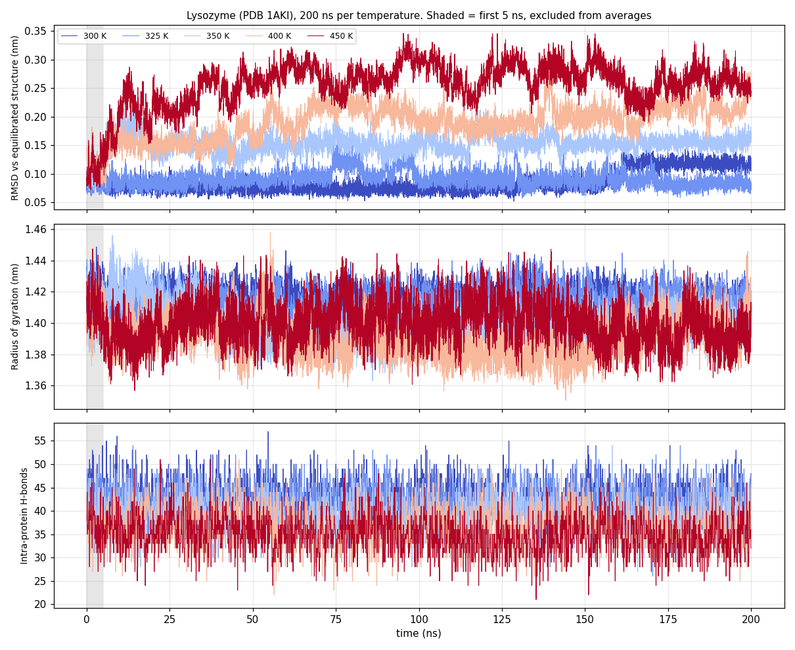
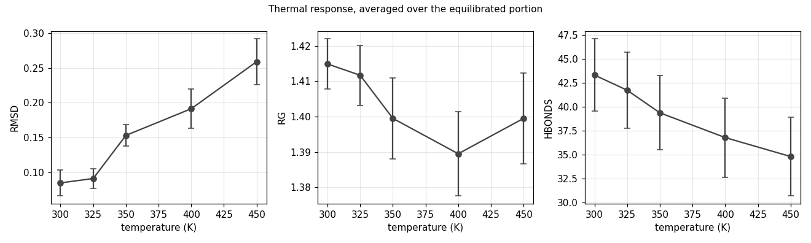
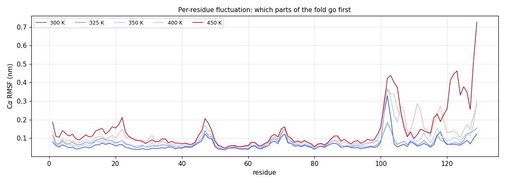

# Chapter 5. Phase 5: thermal stability of lysozyme

*Andrey Maltsev · last updated 2 Nov 2026*

Five independent 200 ns replicas of hen egg-white lysozyme (PDB 1AKI) at 300, 325, 350, 400 and 450 K, analysed with MDAnalysis for RMSD, per-residue RMSF, radius of gyration and backbone hydrogen bonds. One microsecond of aggregate sampling, produced by the ensemble rule that came out of Chapter 4: one replica per node, plus the 450 K replica on the P100 in nightly GPU windows. The result in one line: the fold holds at every temperature, and what changes is *where* the protein is loose, not *whether* it is folded. Section 5.4 records three analysis bugs that each produced confident, wrong numbers before being caught.

## 5.1 What was measured

| | |
| --- | --- |
| System | lysozyme, 129 residues, 1960 protein atoms, amber99sb-ildn / TIP3P |
| Production | NVT, 200 ns per temperature, 2 fs step, 10 ps per frame, 20,001 frames each |
| Trajectories | protein only (`compressed-x-grps = Protein`), 145 MB per replica |
| RMSD reference | the shared 300 K NPT-equilibrated structure, the same one for all five |
| Discarded | first 5 ns of each run before any average |
| H-bonds | backbone only: N as donor, amide H, carbonyl O; 3.5 Å and 150° cutoffs |

The RMSD reference matters. Each replica got its own 1 ns NVT equilibration at its own temperature, so frame 0 at 450 K is already heated. Measuring all five against one common structure is what makes the ladder comparable.

Backbone hydrogen bonds rather than all hydrogen bonds, also deliberately. Backbone N-H···O=C bonds are what secondary structure is made of, so the count reads directly on whether the fold is intact. Letting MDAnalysis guess donors and acceptors pulls in side-chain and surface bonds that add variance without saying anything about the fold.

## 5.2 The fold holds to 450 K

| Measure | 300 K | 325 K | 350 K | 400 K | 450 K | fit against T |
| --- | --- | --- | --- | --- | --- | --- |
| RMSD (nm) | 0.085 | 0.091 | 0.153 | 0.191 | 0.259 | linear, r² = 0.97, +0.0012 nm/K |
| Rg (nm) | 1.415 | 1.412 | 1.399 | 1.389 | 1.399 | flat |
| Backbone H-bonds | 43.3 | 41.7 | 39.4 | 36.8 | 34.8 | linear, r² = 0.98, −0.057 /K |

Radius of gyration stays between 1.389 and 1.415 nm at every temperature, a spread of 2%. Unfolding would carry it past 2 nm. Nothing here unfolds.

What does change is linear. RMSD triples and the backbone loses a fifth of its hydrogen bonds, both in a straight line across 150 K, with no cooperative step anywhere. That is the signature of progressive loosening, not of melting. A melting transition would show as a step in all three measures at one temperature.

The one feature worth a second look is the RMSD step from 325 K to 350 K, +68% against +7%, +25% and +35% for the other intervals. Lysozyme's experimental melting temperature is around 345 K, so the largest step in the ladder sits next to it. With one replica per temperature that is suggestive and no more; it would take three or four replicas per point to say anything.

The small Rg dip at 400 K (1.389 against 1.415 at 300 K) is about 2 to 3 standard deviations, so real but slight, and consistent with mild compaction under constant-volume heating.

## 5.3 Melting is local, not global

This is what per-residue RMSF shows and the averages cannot.

| | 300 K | 325 K | 350 K | 400 K | 450 K |
| --- | --- | --- | --- | --- | --- |
| Rigid core, median RMSF (nm) | 0.052 | 0.062 | 0.069 | 0.082 | 0.090 |
| Mobile regions, median (nm) | 0.072 | 0.086 | 0.121 | 0.195 | 0.341 |
| Ratio | 1.4x | 1.4x | 1.8x | 2.4x | 3.8x |
| Residues below 0.15 nm | 98% | 98% | 91% | 85% | 75% |

Across 150 K the core gains 73% and the mobile regions gain 376%. At 450 K three quarters of the chain is still as rigid as a folded protein while a quarter has come apart, and the single most mobile residue, 129, reaches 0.726 nm, eight times the core median.

The residues that gain the most between 300 K and 450 K are **129, 128, 123, 122, 121, 104, 105, 125, 124, 126, 103, 120**: two regions, the C-terminal tail and the loop around residues 101 to 107. Everything else barely registers the extra 150 K.

The two regions behave differently and the distinction is worth keeping:

- **The C-terminal tail is the clean temperature signal.** Residue 129 runs 0.122, 0.153, 0.303, 0.282, 0.726 nm across the ladder, rising with temperature apart from a dip at 400 K.
- **The 101 to 107 loop is mobile at every temperature, including 300 K**, and its magnitude is not monotonic: 0.329, 0.184, 0.362, 0.368, 0.438 nm. That loop makes occasional large excursions whatever the temperature, and with one replica per point the measured value depends on how many excursions happened to fall inside 200 ns. Treat it as a flexible loop, not as a thermometer.

### A hypothesis that did not survive

Lysozyme has four disulfide bridges (6-127, 30-115, 64-80, 76-94), and the most mobile residues, 128 and 129, lie beyond the last one. The obvious hypothesis is that fluctuation is set by how far a residue sits from the nearest covalent anchor.

It is not. Spearman correlation between sequence distance to the nearest bridged cysteine and RMSF gain from 300 K to 450 K is **+0.046**, which is nothing. The longest unanchored stretch, Cys30 to Cys64 at 34 residues, gains only +0.08 nm, while the shorter Cys94 to Cys115 gains +0.33 nm. Sequence topology does not predict which parts loosen. Three-dimensional context does, and the free C-terminal tail fits the anchoring idea as a single case rather than a rule.

## 5.4 Three analysis bugs, each of which produced confident wrong numbers

None of these touched the simulations. All three were in post-processing, and all three produced output that looked plausible enough to publish.

**Periodic boundaries, the expensive one.** The first run reported Rg 2.53 nm and RMSD 2.10 nm at 300 K, which is a protein torn in half. GROMACS wraps coordinates into the box as it writes them, so once the protein diffuses across a face of the dodecahedron its atoms sit on opposite sides. The clue was in the data: Rg's *minimum* was 1.393 nm, and 15% of frames came in under 1.6 nm with an average RMSD of 0.399 nm. The correct values were present all along, in the frames where the molecule happened to be whole. Backbone H-bond counts were unaffected throughout, because MDAnalysis computes those with minimum-image distances. Fixed with `gmx trjconv -pbc whole`, which is now `make_whole.sh`.

**RMSF over unaligned frames.** With that fixed, RMSF still came out at 0.4 to 1.1 nm, ten times too large, and not ordered by temperature. `AlignTraj` had aligned only the frames from the 5 ns mark onward, but `RMSF` then ran over *all* frames, so the first 500 contributed the protein's diffusion through the box instead of its fluctuation. The scrambled temperature ordering was the tell: it depended on how far each replica happened to drift in its own first 5 ns. Reproduced on a synthetic trajectory drifting 2.4 nm, where it inflated RMSF 5.3-fold. The fix is `start=` on one line.

**A topology MDAnalysis cannot read.** GROMACS 2026.2 writes tpx version 138 and MDAnalysis 2.11's TPR parser does not support it. The analysis uses a protein-only `.gro` instead, which costs nothing: masses are guessed correctly from atom names, and the H-bond step is given explicit donor, hydrogen and acceptor selections so it needs neither bonds nor partial charges.

The lesson that generalises is the first one. Both wrong results were internally consistent, monotonic in places, and had plausible-looking error bars. What exposed them was knowing the right order of magnitude: lysozyme's Rg is 1.4 nm and C-alpha RMSF is tenths of a nanometre. `analyze_lyso.py` now carries a guard for the periodic-boundary case, warning when Rg's median sits more than 25% above its 5th percentile, since a folded protein's Rg barely moves and a large spread means a broken input rather than an interesting protein.

## 5.5 What this experiment cannot say

- **Constant volume.** Production was NVT with `pcoupl = no`, chosen so TIP3P would not superheat. The box is therefore frozen at its 300 K density, and the 450 K system sits under high pressure, which opposes expansion and unfolding. "Folded at 450 K" describes this ensemble, not dilute solution.
- **200 ns is short.** Thermal denaturation takes far longer, so the absence of an unfolding event is weak evidence either way.
- **One replica per temperature.** Enough for the core trends, which are smooth and monotonic, and not enough for the 101 to 107 loop or for the 325 K to 350 K step.
- **Disulfides unverified.** The rigid core is consistent with the four bridges being present, but that was not confirmed in the topology. If `pdb2gmx` did not form them, the core's rigidity needs another explanation.

The natural next step is three replicas at 350 K alone, which is both the experimental melting temperature and where the largest step appears. At 27 ns/day per node that is about a week of cluster time for a result the current data only hints at.
