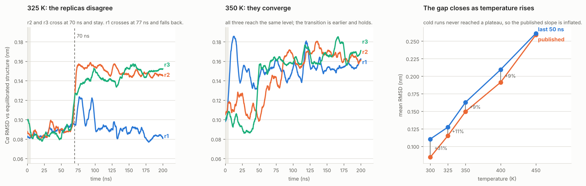

# Chapter 6. Phase 6: what replication did to Chapter 5

*Andrey Maltsev · last updated 14 Nov 2026*

Chapter 5 reported a +68% jump in mean RMSD between 325 K and 350 K, the largest step in the ladder and conveniently close to lysozyme's experimental melting point of about 345 K. It rested on one trajectory per temperature. Phase 6 replicated both ends to n=3, 200 ns each, to find out whether the step was real.

It is smaller than reported, and finding out why exposed something that matters more than the step: **the 200 ns runs never reached a plateau, and how far short they fell depends on temperature.** Mean RMSD over the published window is therefore not an equilibrium property, and part of what Chapter 5 presented as a thermal response is the relaxation rate varying with temperature.

The radius of gyration and the backbone hydrogen-bond results are unaffected. Section 6.4 separates what stands from what does not.

## 6.1 The step

| | 325 K | 350 K | step |
| --- | --- | --- | --- |
| Chapter 5, n=1 | 0.0908 nm | 0.1529 nm | +68% |
| Phase 6, n=3 | 0.1152 nm | 0.1495 nm | +30% |

Two new replicas at each temperature, independent through fresh velocities generated from the shared 300 K NPT structure with recorded seeds (325002, 325003, 350002, 350003). The Chapter 5 runs used `gen-seed = -1`, so they cannot be reproduced exactly; everything from here carries its seed in the mdp and in this repository.

The Chapter 5 replica at 325 K measured 0.0908 nm. The two new ones measured 0.1293 and 0.1254 nm, agreeing with each other to within 0.0039 nm. The original sits 0.0366 nm below them, thirteen times that spread.

## 6.2 What the 325 K replicas actually did

The three runs are not randomly scattered. They follow the same path and then part company at one moment.

| block (ns) | r1 | r2 | r3 |
| --- | --- | --- | --- |
| 0 to 25 | 0.0828 | 0.0841 | 0.0840 |
| 50 to 75 | 0.0940 | 0.1024 | 0.1009 |
| 75 to 100 | 0.1109 | 0.1551 | 0.1406 |
| 100 to 125 | 0.0904 | 0.1511 | 0.1426 |
| 175 to 200 | 0.0814 | 0.1458 | 0.1498 |

All three sit in the same state for about 70 ns. r2 crosses to a higher level at 70 ns and stays. r3 crosses at 70 ns and stays. r1 crosses at 77 ns and falls back, spending 5.6% of its frames in the upper state against 67% and 66% for the other two.

The two states are sharply separated and reproducible across the three independent runs:

| | RMSD | Rg | backbone H-bonds |
| --- | --- | --- | --- |
| lower state | 0.0881 nm | 1.4113 nm | 42.07 |
| upper state | 0.1469 nm | 1.4025 nm | 40.61 |
| separation | 5.3 within-state SD | 1.0 SD | 0.4 SD |

The lower state measures 0.0886, 0.0881 and 0.0867 nm in the three runs, agreeing to within 0.002 nm. The states are well defined; what differs between replicas is how long each spends in them. The transition is clean in RMSD and barely visible in Rg or hydrogen-bond count, which fits the Chapter 5 RMSF result: the motion lives in the C-terminal tail and the loop at residues 101 to 107, so atoms travel a long way without the molecule changing size. The upper state is slightly more compact.

So the published mean is a mixture average rather than an equilibrium value: r1 is 94% lower state, r2 and r3 are about one third lower and two thirds upper. Each 200 ns run contains roughly one transition, so the occupancy it reports is close to a coin flip, and the Welch test built for this phase was comparing two mixtures with uncontrolled weights. That is why it could not resolve the interval, and it would not have resolved it at n=10 either. The 5 ns equilibration discard is also beside the point; the relevant timescale is 70 ns.

## 6.3 The ladder-wide problem

Applying the same block analysis to all nine runs shows 325 K is a special case of something general. Every trajectory relaxes away from the common starting structure, and the relaxation is slower at lower temperature.

T300 sits near 0.073 nm through its first 125 ns, then climbs to 0.118 nm in the final block. **It is still rising when the run ends**, at +0.067 nm per 100 ns with p effectively zero. Its reported mean of 0.0845 nm was taken while the system was still moving.

Comparing the published 5 to 200 ns mean against the last 50 ns of each run makes the pattern explicit:

| T (K) | n | published | last 50 ns | under-estimate |
| --- | --- | --- | --- | --- |
| 300 | 1 | 0.0845 | 0.1104 | 31% |
| 325 | 3 | 0.1152 | 0.1273 | 11% |
| 350 | 3 | 0.1496 | 0.1628 | 9% |
| 400 | 1 | 0.1913 | 0.2095 | 9% |
| 450 | 1 | 0.2590 | 0.2612 | 1% |

The bias is large at the cold end and gone by 450 K, which is what a temperature-dependent relaxation rate produces. Recomputed on the last 50 ns the RMSD slope against temperature drops 9%, and even that understates the correction because T300 and T400 had not finished moving.

One earlier claim of ours needs withdrawing too. The three 350 K replicas appeared to agree to 2%, which looked like excellent reproducibility. On the last 50 ns they give 0.1541, 0.1644 and 0.1697 nm, a spread of 4.8%. The tight agreement in the published numbers was mixture averaging landing in the same place by coincidence.

## 6.4 What stands and what does not

The relaxation hits the three measures very differently, and the reason is structural. RMSD is measured against a fixed reference, so it accumulates as the protein wanders away from it. Radius of gyration and hydrogen-bond count are properties of the current structure and equilibrate fast.

| T (K) | RMSD bias | Rg bias | H-bond bias |
| --- | --- | --- | --- |
| 300 | +31% | −0.1% | −1.1% |
| 325 | +11% | −0.1% | −1.1% |
| 350 | +9% | −0.2% | −1.5% |
| 400 | +9% | +0.4% | −0.9% |
| 450 | +1% | −0.4% | −1.3% |
| slope change | **−9%** | +8% on a flat line | **−1%** |

**Stands.** Lysozyme does not unfold anywhere on the ladder: Rg never leaves 1.389 to 1.415 nm, in any replica, at any point in any trajectory, and the relaxation bias on it is under half a percent with no systematic direction. The backbone hydrogen-bond response is real and linear, 43.3 to 34.8 bonds from 300 to 450 K with r² = 0.98, and correcting for relaxation changes that slope by 1%. The 325 to 350 K interval **is** resolved in hydrogen bonds: −2.19 with a 95% CI of [−2.96, −1.42], p = 0.0028, because that measure is not relaxation-limited. The local-rather-than-global finding rests on which residues move rather than on absolute values, so it is largely insulated, though it is worth re-deriving on the last 50 ns.

**Does not stand.** The +68% step: it is +30% at n=3, and even that compares two mixtures. The RMSD values as equilibrium quantities, at 300 K above all, where the true plateau is unknown because the run ended while still climbing. The linear RMSD response with r² = 0.97, since part of that slope is relaxation rate rather than structural response. And the 2% reproducibility at 350 K.

None of this touches the simulations. Every trajectory is valid molecular dynamics. The problem is that 200 ns is shorter than the process being measured, and the analysis window assumed otherwise.

## 6.5 Why Phase 7 is not more replicas

The obvious next step is more 200 ns runs, and it is the wrong one. More runs of the same length estimate the mixture weight more precisely, and the mixture weight is an artefact of the runs being too short. At one transition per run, usable error bars on occupancy would need twenty or more replicas, about five weeks of the whole cluster, to measure something that only exists because of the window.

Extending the existing runs is both cheaper and better, and the arithmetic favours the GPU heavily:

| | rate | 200 ns more |
| --- | --- | --- |
| compute node | 23.7 ns/day | 8.4 days |
| P100, 7 h nightly window | 339 ns/day, about 99 ns a night | 2 nights |

Every run has a checkpoint, so continuation is free. In priority order: T300 to 600 ns, since it is the worst case and anchors the cold end of every fit in the project; T400 to 400 ns, also still rising when it stopped; and T325 r1 to 400 ns, which tests directly whether it eventually makes the transition the other two made. Eight nights of an otherwise idle card against five weeks of the cluster.

Three things are worth doing immediately and cost nothing: re-derive RMSF on the last 50 ns rather than the full window; add a convergence guard to the analysis, as the periodic-boundary guard was added after Chapter 5, so that a significant trend in the final quarter stops a mean being reported at all; and quote the plateau rather than the window mean once the extensions land.

This is the fourth analysis error the project has documented, after the periodic-boundary bug, the RMSF alignment bug and the ESXi oversubscription confound. It is the most consequential, because unlike the others it produced numbers that looked entirely reasonable and went into a published chapter. Replication was run to test a 68% step, found it was 30%, and in explaining the difference found that the measurement window was shorter than the process. That is a better outcome than confirming the step would have been.
