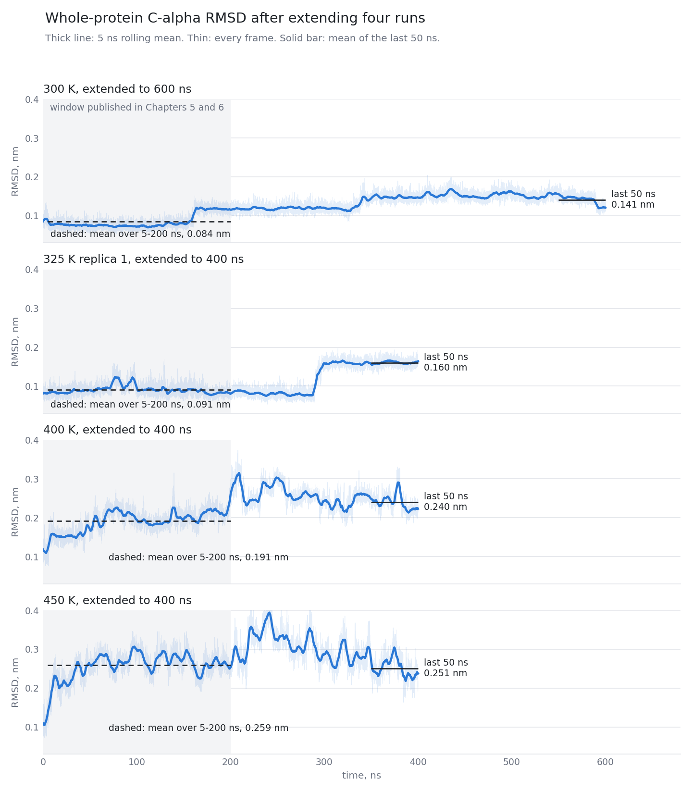
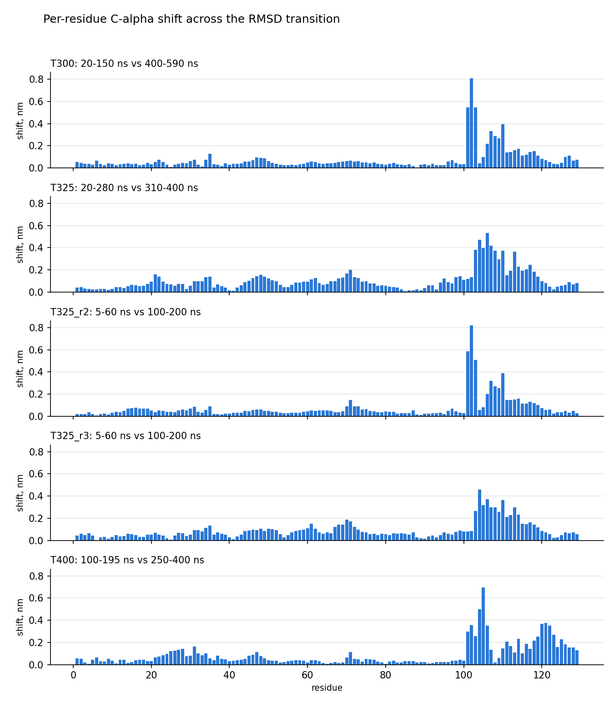
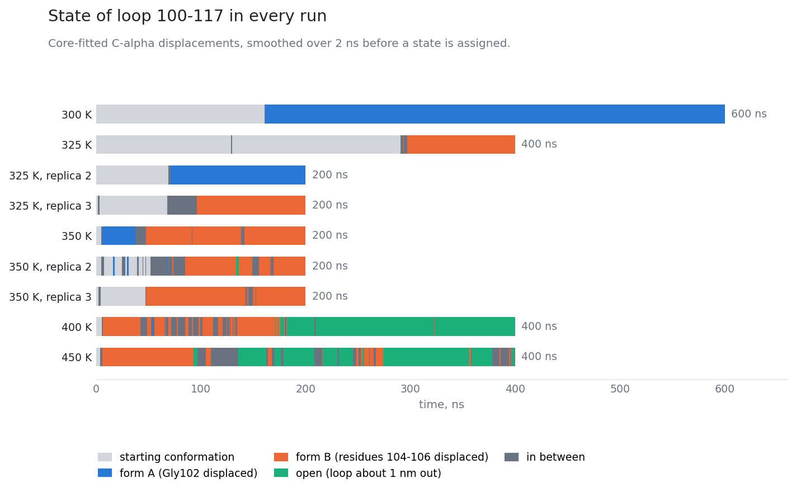
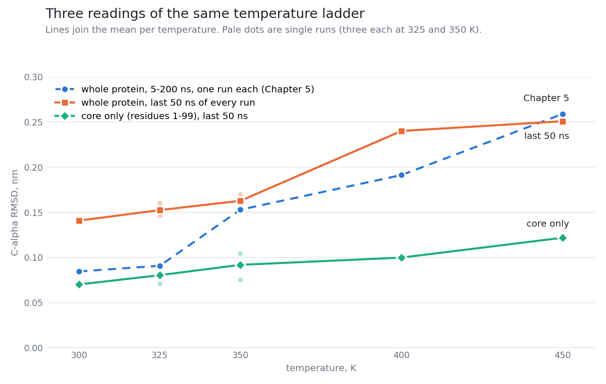

# Chapter 7. Phase 7: what longer runs showed

*Andrey Maltsev · last updated 17 Nov 2026*

Four of the nine lysozyme runs were continued from their checkpoints: 300 K to 600 ns, 325 K replica 1, 400 K and 450 K to 400 ns each. One more microsecond, 2.8 µs in total. The result in one line: the RMSD ladder of Chapter 5 was mostly a clock, not a thermometer. Every run at 300 to 350 K leaves its starting conformation through the same loop, residues 100 to 117, and temperature decides how long that takes far more than where the protein ends up. With the loop taken out of the measurement, the rest of the fold gives a small, smooth and converged response to temperature. Sections 7.6 and 7.7 list what this corrects in Chapters 5 and 6.

## 7.1 What was run

| Run | From | To | Card | Rate |
| --- | --- | --- | --- | --- |
| 300 K | 200 ns | 600 ns | V100 | 605 ns/day |
| 325 K, replica 1 | 200 ns | 400 ns | V100 | 588 ns/day |
| 400 K | 200 ns | 400 ns | P100, last 21 ns on V100 | 290 to 330, then 602 ns/day |
| 450 K | 200 ns | 400 ns | V100 | 593 ns/day |

The runs were not restarted. `gmx convert-tpr -until` raises the end time of the existing `prod.tpr`, and `gmx mdrun -cpi prod.cpt -append` continues the same trajectory, energy and log files. Each extended trajectory has exactly one frame every 10 ps from 0 to its end (60,001 or 40,001 frames), with no duplicate at a restart point. A doubled frame there would have been the first sign of a bad append.

Why these four. Chapter 6 found that every run was still drifting in RMSD at 200 ns, the 300 K run most of all. 325 K replica 1 was the outlier of its group. 400 and 450 K were the two single runs above the replicated range.

## 7.2 Two GPUs on one host, and a pinning fault

The V100 on the GPU host is held by the RAG stack, but GROMACS needs only about 330 MiB of its memory, so the two can share the card. Alone, the V100 runs this system at 627 ns/day against 339 on the P100, a factor of 1.85.

The first night with both cards busy gave 324 and 290 ns/day instead. The cause was CPU pinning. The host has 12 cores with hyperthreading, and mdrun then pins with a stride of 2 logical CPUs. With `-ntomp 4`, an offset of 0 takes cores 0 to 3 and an offset of 4 takes cores 2 to 5, not 4 to 7. Two cores carried both runs. `taskset -cp` on the mdrun threads showed it directly: the V100 job sat on CPUs 2, 3, 4, 5.

| | Shared cores | Offset 8 for the V100 job | Alone |
| --- | --- | --- | --- |
| P100 | 290 | 330 | 339 |
| V100 | about 324 | 585 to 588 | 592 to 627 |
| Both | about 614 | about 915 | |

The rule that came out of it: with hyperthreading on, `-pinoffset` counts logical CPUs, so a second 4-thread job needs an offset of 8. Check with `taskset`, not by arithmetic.

## 7.3 The published means were not converged

| Run | 5 to 200 ns (published) | Last 50 ns | Change |
| --- | --- | --- | --- |
| 300 K | 0.085 nm | 0.141 nm | +66% |
| 325 K, replica 1 | 0.091 nm | 0.160 nm | +77% |
| 400 K | 0.191 nm | 0.240 nm | +26% |
| 450 K | 0.259 nm | 0.251 nm | −3% |

The 300 K run sat at 0.076 nm for 150 ns, stepped to 0.12 nm at about 160 ns and to 0.15 nm at about 340 ns, and then held 0.150 nm for the last 250 ns with a slope of −0.004 nm per 100 ns. The 325 K replica stayed at 0.088 nm for 290 ns and then jumped to 0.160 nm within a few nanoseconds. Neither change was visible, or predictable, from the first 200 ns.

The steps at 400 and 450 K fall close to the 200 ns restart point, which needed a check. At 400 K the movement starts at 198 ns, two nanoseconds before the restart and still inside the original run. At 450 K the rise after 200 ns is within the range the run had already covered. A continuation from a checkpoint carries the full state, and the two runs at 300 and 325 K pass through 200 ns without any change. The timing is a coincidence.

## 7.4 One loop, two end states

To find what moves, each run was split into a window before the RMSD step and one after it, and the mean C-alpha position of every residue was compared between the two (`analyze_transition.py`).

The movement is confined to residues 100 to 117. At 300 K the twelve most displaced residues carry 83% of the squared shift, and residues 1 to 99 barely move. The loop ends in one of two forms:

| Form | Leading residues | Gly102 | Met105 | Rg after | Seen in |
| --- | --- | --- | --- | --- | --- |
| A | Asp101, Gly102, Asn103 | 0.75 nm | 0.15 nm | 1.41 nm | 300 K; 325 K replica 2 |
| B | Gly104, Met105, Asn106 | 0.20 to 0.29 nm | 0.48 to 0.54 nm | 1.39 to 1.40 nm | 325 K replicas 1 and 3; all three at 350 K |
| open | 104 to 106, plus the C-terminal tail | 0.4 to 0.6 nm | 0.8 to 1.1 nm | 1.40 to 1.41 nm | 400 K, 450 K |

Displacements are from the reference after fitting on the core, last 50 ns of each run.

Form A is reproducible to a degree that rules out noise. The 300 K run and 325 K replica 2 are independent trajectories at different temperatures, and they agree residue by residue: Gly102 0.757 and 0.754 nm, with the same secondary group at 107 to 110. In form A the loop also becomes more ordered. RMSF of residues 101 to 103 falls from 0.10 to 0.21 nm before the switch to 0.08 nm after it. This is a move to a second defined conformation, not a loss of structure.

The two forms also explain the split in radius of gyration that Chapter 6 could not: the runs with the lower Rg are exactly the runs in form B.

| T | Time until the loop leaves the starting conformation |
| --- | --- |
| 300 K | 162 ns |
| 325 K | 70, 70 and 292 ns |
| 350 K | 6, 48 and 56 ns |
| 400 K, 450 K | under 6 ns |

Waiting times shorten with temperature and scatter by a factor of four within one temperature. A 200 ns window therefore catches some runs before the switch and some after it, and that mixture is what Chapter 5 read as a temperature ladder and Chapter 6 as bistable replicas.

Is the switch physical? The region is known to be mobile. Residues 100 to 104 belong to substrate subsite A, and a crystallographic comparison of two independent molecules attributes high flexibility to them ([PDB 1LYS](https://proteopedia.org/w/1lys)). A 2022 crystal and NMR study found two different local conformations of the Asp101-Gly102 peptide bond ([Oda et al., Protein J. 41, 71](https://doi.org/10.1007/s10930-021-10036-3)), the same residues that lead form A. That supports a real conformational freedom at this position. It does not show that forms A and B as simulated here are the experimental ones, and lysozyme loops are also a classic place for force-field error. That question stays open.

## 7.5 The core ladder

Fitting every frame on residues 1 to 99 only and measuring the RMSD of those residues (`analyze_core.py`) removes the loop from the result.

| T | Core RMSD, 5 to 200 ns | Core RMSD, last 50 ns | Whole protein, last 50 ns | Backbone H-bonds, last 50 ns | Runs |
| --- | --- | --- | --- | --- | --- |
| 300 K | 0.064 | 0.070 | 0.141 | 41.4 | 1 |
| 325 K | 0.078 ± 0.002 | 0.080 ± 0.010 | 0.153 ± 0.007 | 40.2 ± 0.2 | 3 |
| 350 K | 0.091 ± 0.008 | 0.092 ± 0.015 | 0.163 ± 0.008 | 38.6 ± 0.5 | 3 |
| 400 K | 0.107 | 0.100 | 0.240 | 36.7 | 1 |
| 450 K | 0.123 | 0.122 | 0.251 | 34.6 | 1 |

RMSD in nm; ± is the standard deviation between replicas.

Three things stand out.

**The core ladder is converged.** The mean over 5 to 200 ns and the mean over the last 50 ns agree within about 10% at every temperature. For the whole protein the same comparison was off by 66% at 300 K.

**It is smooth and small.** Core RMSD rises by about 0.004 nm per 10 K, with a correlation of 0.99 against temperature over the five points. The core at 450 K (0.12 nm) deviates less than the whole protein does at 300 K once its loop has switched (0.14 nm).

**The whole protein falls into two groups.** 0.14 to 0.16 nm at 300 to 350 K, where the loop is in form A or B, and 0.24 to 0.25 nm at 400 and 450 K, where the loop is open and the C-terminal tail has moved. The gap between the groups is a change of loop state, not a gradual loosening.

The core is not perfectly independent of the loop. Core RMSD rises from 0.063 to 0.075 nm at 300 K and from 0.071 to 0.091 nm in 325 K replica 1 when the loop switches. Residues next to the loop follow it a little.

## 7.6 What this corrects in Chapter 5

- **Section 5.2, RMSD row and the linear fit (+0.0012 nm/K, r² = 0.97).** The values at 300 and 325 K were taken while the loop was still in its starting conformation. The fit described waiting times, not an equilibrium response. Use the core ladder of section 7.5 instead.
- **Section 5.2, the step from 325 to 350 K (+68%).** Already reduced to +30% in Chapter 6. On the last 50 ns of every run it is +7% and not significant (p = 0.17).
- **Still valid:** the fold holds to 450 K, Rg stays within 2%, the backbone loses hydrogen bonds linearly with temperature, and the loosening is local. Loop 101 to 107 was already the RMSF hotspot in section 5.3. This chapter supplies the mechanism.

## 7.7 What this corrects in Chapter 6

- **The two states at 325 K** (0.088 and 0.147 nm) are the starting conformation and the switched loop. Replica 1 was not an outlier. It switched at 292 ns instead of 70.
- **The hydrogen-bond difference between 325 and 350 K survives**, smaller: −1.57 bonds on the last 50 ns (Welch p = 0.019), against −2.19 over 5 to 200 ns.
- **The observation that every run was under-converged in RMSD** is confirmed, and its cause is now known.

## 7.8 What this experiment cannot say

- 300, 400 and 450 K are single runs. The 300 K plateau is one trajectory, and it dipped to 0.125 nm in its last 10 ns.
- A flat 250 ns is evidence of a plateau, not proof. One run in this set was flat for 290 ns and then jumped.
- Which form the loop prefers at which temperature is not resolved. Form A appears in 1 of 1 runs at 300 K, 1 of 3 at 325 K and 0 of 3 at 350 K. One run at 350 K passed through form A for 30 ns on its way to form B. Seven runs suggest a trend and cannot test it.
- Neighbouring temperatures are not separated in core RMSD: 325 against 350 K gives +0.013 nm with p = 0.10 over 5 to 200 ns. The trend across five temperatures is the result, not any single step.
- Whether forms A and B exist in solution, or come from the force field (amber99sb-ildn), needs a comparison against NMR data that is outside this project.
- The runs are NVT. At 400 and 450 K the water is far above its boiling point at the density of 300 K, so those two temperatures probe a stressed model system, not a physical state of the protein.

## 7.9 Reproducing this chapter

| Step | Script | Host |
| --- | --- | --- |
| Extend a run from its checkpoint | `scripts/lysozyme/extend_lyso_gpu.sh` | GPU host |
| Progress and time left | `scripts/lysozyme/lyso_eta.sh` | GPU host |
| Make molecules whole | `scripts/lysozyme/make_whole.sh` | head node |
| RMSD, Rg, H-bonds per run | `analysis/analyze_lyso.py` | head node |
| Per-residue shift across the transition | `analysis/analyze_transition.py` | head node |
| Core, loop and tail separately | `analysis/analyze_core.py` | head node |
| Figures of this chapter | `analysis/make_phase7_figs.py` | head node |

`data/phase7/per_run.csv` and `by_temperature.csv` hold every number in the tables above. The time series behind the figures are about 14 MB and stay on the cluster; `analyze_lyso.py` and `analyze_core.py` regenerate them from the trajectories.
